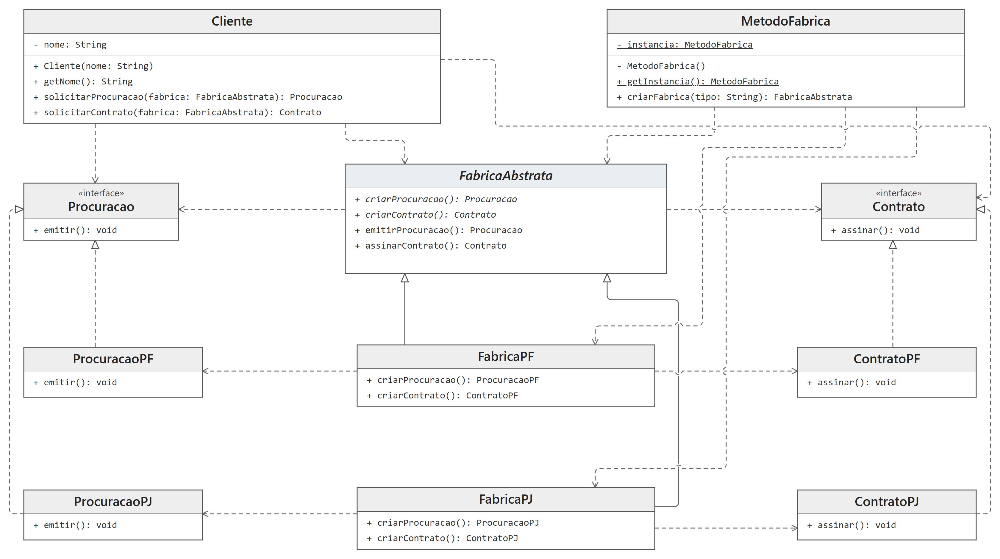

# DCC078 - Padrões de Projeto: Singleton, Factory Method e Abstract Factory

**Aluno:** Felipe Lazzarini Cunha

## Tema

Emissão de documentos para pessoas físicas (PF) e jurídicas (PJ). O Singleton `MetodoFabrica` centraliza a seleção das fábricas, e o Abstract Factory reúne a criação de contratos e procurações de cada família. O Factory Method aparece nos métodos `criarProcuracao()` e `criarContrato()`, definidos em `FabricaAbstrata` e sobrescritos pelas fábricas concretas; as operações de emissão e assinatura usam esses métodos. A emissão e a assinatura são simuladas por mensagens no console.

## Diagrama de Classes UML



## Estrutura do Projeto

- `MetodoFabrica`: Singleton responsável por selecionar a fábrica PF ou PJ.
- `FabricaAbstrata`: define os métodos de criação e as operações que emitem procurações e assinam contratos.
- `FabricaPF` e `FabricaPJ`: criam os documentos de cada família.
- `Procuracao` e `Contrato`: interfaces dos documentos, implementadas pelas variantes PF e PJ.
- `Cliente`: solicita os documentos por meio da fábrica abstrata.
- `Main`: demonstra a integração dos três padrões.

## Testes

Requisitos: Java 17 ou superior e Maven 3.

```bash
mvn test
```
